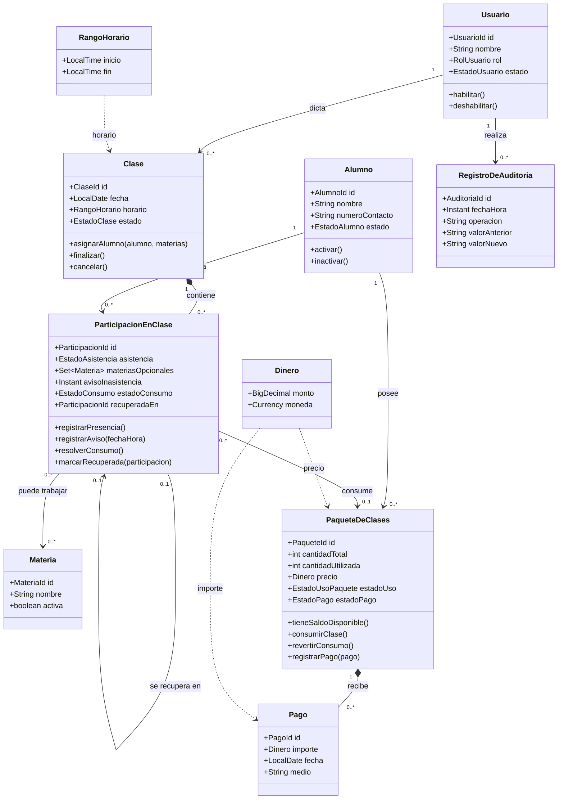

# Modelado del dominio

Este documento describe conceptos y reglas del negocio. La representación en código sigue la arquitectura por capas definida en [04-arquitectura.md](04-arquitectura.md); actualmente, los modelos persistidos también son entidades JPA.

## 1. Descripción del dominio

El sistema pertenece al dominio de gestión operativa de una academia pequeña. La academia administra una base general de alumnos y permite que distintos profesores organicen clases con fechas, horarios y listas variables de participantes.

No existen grupos o comisiones permanentes. Una clase es una sesión concreta de un profesor y puede tener una combinación de alumnos diferente a la de otra sesión. En una misma clase, cada alumno puede trabajar una materia distinta, varias materias o ninguna materia específica.

El sistema resuelve principalmente estos problemas:

- conocer quién participa de cada clase y cuál fue su asistencia;
- controlar cuántas clases compró y utilizó cada alumno;
- gestionar ausencias justificadas y recuperaciones;
- registrar pagos completos, parciales y deudas;
- conservar el historial de cambios realizados por los usuarios.

El dominio distingue entre:

- **asistencia**: si el alumno estuvo presente o informó una ausencia;
- **consumo**: si la participación descuenta una clase del paquete;
- **pago**: cuánto dinero se abonó por un paquete.

## 2. Entidades

### Alumno

Representa a una persona registrada en la academia.

**Atributos principales:**

- identificador;
- nombre y apellido;
- número de contacto;
- observaciones opcionales;
- estado: activo o inactivo;
- fecha de alta y, opcionalmente, fecha de inactivación.

**Responsabilidades:**

- cambiar entre estado activo e inactivo;
- conservar su historial aunque deje de asistir;
- volver a estar activo cuando retoma la actividad.

No se registra documento ni correo electrónico porque no son necesarios para el alcance actual. El alumno tiene identidad propia y no debe eliminarse físicamente si posee historial.

### Usuario

Representa a una persona autenticada que utiliza el sistema.

**Atributos principales:**

- identificador;
- nombre;
- credenciales de acceso;
- rol: administrador o profesor;
- estado: activo o inactivo.

**Responsabilidades:**

- autenticarse;
- realizar operaciones permitidas por su rol;
- quedar registrado como autor de las modificaciones.

El rol de profesor identifica al usuario que dicta clases. No se crea una entidad `Profesor` separada mientras no existan datos propios del profesor que justifiquen esa separación.

### Materia

Representa una disciplina o asignatura ofrecida por la academia.

**Atributos principales:**

- identificador;
- nombre;
- descripción opcional;
- estado activo o inactivo.

Una materia no pertenece obligatoriamente a una clase. Se registra en la participación del alumno cuando se desea especificar qué trabajó.

En E3 se implementan alta, consulta, edición y cambio de estado de materias. La relación entre una materia y una participación se incorporará en E4.

### Clase

Representa una sesión concreta dictada por un profesor.

**Atributos principales:**

- identificador;
- profesor responsable;
- fecha;
- hora de inicio y finalización, o duración;
- estado: programada, finalizada o cancelada;
- observaciones opcionales.

**Responsabilidades:**

- registrar sus datos de programación;
- admitir alumnos asignados;
- finalizarse cuando pasa su fecha y horario;
- resolver el consumo de las participaciones;
- cancelarse sin consumir clases cuando la cancelación corresponde a la academia.

La clase no tiene una materia obligatoria. Esto permite que un profesor trabaje materias diferentes con alumnos distintos durante la misma sesión.

En E3, una clase nueva comienza en estado `SCHEDULED`. Solo las clases programadas pueden editarse o cancelarse; la cancelación cambia su estado a `CANCELLED`. El cambio automático a `FINALIZED` y la resolución de consumos se incorporarán en E6. El profesor asociado no puede cambiarse al editar la clase. El horario debe tener una hora de fin posterior a la de inicio, dentro de la misma fecha.

### ParticipaciónEnClase

Representa la asignación de un alumno a una clase concreta y concentra el estado administrativo de esa participación.

**Atributos principales:**

- identificador;
- alumno;
- clase;
- cero, una o varias materias trabajadas;
- estado de asistencia: pendiente, presente, ausencia justificada o ausencia no justificada;
- fecha y hora del aviso de inasistencia, si existe;
- estado de consumo;
- referencia opcional a la participación donde se recuperó la clase.

**Responsabilidades:**

- registrar asistencia;
- registrar una ausencia y su aviso;
- determinar, al finalizar la clase, si corresponde consumir una clase;
- indicar si la ausencia justificada todavía está pendiente de recuperación;
- impedir que el alumno sea asignado dos veces a la misma clase.

Esta entidad es necesaria porque la asistencia y el consumo pertenecen a la relación entre alumno y clase.

### PaqueteDeClases

Representa una cantidad de clases adquirida por un alumno.

**Atributos principales:**

- identificador;
- alumno;
- cantidad total de clases;
- cantidad utilizada;
- fecha de compra o registro;
- precio acordado;
- estado de uso: pendiente, en uso o agotado;
- estado de pago: pendiente, parcial o pagado.

**Responsabilidades:**

- recibir pagos;
- incrementar o corregir la cantidad utilizada mediante operaciones controladas;
- informar clases disponibles;
- determinar si puede utilizarse para un nuevo consumo;
- permanecer en espera si existe un paquete anterior en curso;
- pasar a agotado cuando se utilizan todas sus clases.

El saldo se calcula como `cantidad total - cantidad utilizada`. La cantidad utilizada no debe modificarse directamente sin una operación de negocio auditable.

### Pago

Representa un importe abonado por un alumno para un paquete.

**Atributos principales:**

- identificador;
- paquete asociado;
- importe;
- fecha;
- medio de pago, si se registra;
- usuario que lo registró;
- observaciones.

**Responsabilidades:**

- aplicar un importe al paquete;
- participar en el cálculo del estado de pago;
- impedir que el total abonado supere el precio del paquete, salvo decisión futura explícita.

### RegistroDeAuditoria

Representa el historial de una modificación relevante.

**Atributos principales:**

- identificador;
- usuario que realizó el cambio;
- fecha y hora;
- tipo de entidad afectada;
- identificador del objeto afectado;
- operación realizada;
- valor anterior;
- valor nuevo.

**Responsabilidades:**

- conservar evidencia de cambios sobre pagos, asistencias, clases, paquetes y estados;
- permitir consultar quién modificó un dato y cuándo.

Es un concepto transversal de soporte. No reemplaza el estado actual de las entidades.

## 3. Objetos de valor

### Dinero

Representa un importe monetario junto con su moneda.

**Propiedades:**

- monto decimal exacto;
- moneda, inicialmente ARS.

Debe ser inmutable y centralizar operaciones como suma, comparación y resta sin utilizar valores de punto flotante para dinero.

### RangoHorario

Representa la hora de inicio y finalización de una clase. Debe validar que la finalización sea posterior al inicio.

No se proponen objetos de valor para cada atributo por defecto. Solo se incorporan cuando encapsulan una regla o validación útil.

## 4. Relaciones

- Un `Usuario` con rol profesor puede dictar muchas `Clase`.
- Una `Clase` corresponde a un profesor y tiene una fecha y un horario.
- Una `Clase` tiene cero o muchas `ParticipaciónEnClase`.
- Un `Alumno` puede tener cero o muchas participaciones.
- Una combinación de alumno y clase no puede repetirse.
- Una `ParticipaciónEnClase` puede referenciar cero o varias `Materia`.
- Un `Alumno` puede tener cero o muchos `PaqueteDeClases`.
- Un `PaqueteDeClases` puede tener cero o muchos `Pago`.
- Una `ParticipaciónEnClase` puede utilizar como máximo una clase de un paquete.
- Una participación justificada puede tener cero o una referencia a la participación futura donde fue recuperada.
- Un `RegistroDeAuditoria` corresponde a un cambio realizado por un usuario sobre una entidad.

La relación entre materias y participaciones es opcional. Una participación sin materias representa una clase cuyo contenido no se especificó.

## 5. Reglas de negocio, validaciones e invariantes

### Alumnos

- Un alumno activo puede ser asignado a nuevas clases.
- Un alumno inactivo conserva su historial.
- La reactivación no crea un alumno nuevo.
- No se elimina físicamente un alumno con clases, pagos o paquetes históricos.

### Clases y participaciones

- Una clase debe tener profesor, fecha y horario válidos.
- Una misma persona no puede participar dos veces de la misma clase.
- La clase puede tener alumnos que trabajen materias diferentes.
- Una participación puede no tener ninguna materia especificada.
- Una clase cancelada por la academia no consume clases de los alumnos asignados.
- La clase se considera finalizada cuando pasa su fecha y horario.
- Al finalizar la clase, cada participación debe resolverse como presente, ausencia justificada o ausencia no justificada.

### Avisos y consumo

- Un aviso recibido con una anticipación de al menos 12 horas produce una ausencia justificada.
- Una ausencia justificada no consume una clase y queda pendiente de recuperación.
- Una ausencia sin aviso suficiente se considera no justificada y consume una clase.
- La asistencia consume una clase al finalizar la clase.
- La decisión de consumo debe registrarse una sola vez por participación.
- Una participación no puede descontar más de una clase.
- Una corrección posterior debe modificar el estado y el contador mediante una operación auditable.

### Recuperaciones

- Solo una ausencia justificada puede recuperarse.
- La recuperación puede realizarse en una clase futura disponible.
- La recuperación puede ser gestionada manualmente por un profesor o administrador.
- Una participación recuperable pasa a estado recuperada cuando se vincula con una participación futura.
- Una recuperación ya utilizada no puede volver a utilizarse.
- La clase recuperada no genera un descuento adicional.

### Paquetes y pagos

- Un paquete debe tener una cantidad positiva de clases y un precio válido.
- El total de pagos no debe superar el precio del paquete, salvo decisión futura explícita.
- Un paquete puede estar pendiente, parcialmente pagado o totalmente pagado.
- Un alumno puede tener varios paquetes.
- Un paquete futuro puede pagarse antes de comenzar a utilizarlo.
- El consumo se aplica primero al paquete en curso más antiguo con saldo disponible.
- Un paquete futuro no se utiliza mientras exista un paquete anterior en curso.
- Cuando el paquete en curso se agota, el siguiente paquete elegible pasa a estar disponible.
- Un alumno puede asistir aunque tenga deuda; la deuda queda registrada.

### Auditoría

- Las modificaciones de pagos, asistencias, paquetes, clases y estados deben identificar usuario y fecha.
- Las correcciones deben conservar el valor anterior y el nuevo.
- El historial no debe reemplazar el dato actual ni impedir su consulta.

## 6. Comportamientos del dominio

El modelo debe expresar operaciones de negocio y no limitarse a exponer atributos.

### Alumno

- `activar()` cambia un alumno inactivo a activo.
- `inactivar()` cambia un alumno activo a inactivo sin borrar información.

### Clase

- `asignarAlumno(alumno, materias)` crea una participación si no existe y si el alumno puede ser asignado.
- `cancelar()` cambia el estado de la clase y evita consumos.
- `finalizar()` cierra la clase y habilita la resolución de las participaciones.

### ParticipaciónEnClase

- `agregarMateria(materia)` agrega una materia trabajada sin hacerla obligatoria.
- `registrarPresencia()` marca la asistencia.
- `registrarAvisoDeInasistencia(fechaHora)` determina si el aviso cumple el plazo de 12 horas.
- `resolverConsumo()` cambia el estado a consumida o justificada pendiente de recuperar.
- `marcarRecuperada(participacionFutura)` vincula la recuperación y evita un nuevo descuento.

### PaqueteDeClases

- `registrarPago(pago)` actualiza el estado de pago.
- `consumirClase()` incrementa la cantidad utilizada si el paquete es elegible y tiene saldo.
- `revertirConsumo()` permite corregir un consumo con auditoría.
- `tieneSaldoDisponible()` informa si queda alguna clase utilizable.
- `estaAgotado()` informa si ya no tiene clases disponibles.

Las operaciones que coordinan varias entidades, como finalizar una clase y consumir paquetes de varios alumnos, pueden pertenecer a la capa de aplicación. No se introduce un servicio de dominio separado sin evidencia de que sea necesario.

## 7. Estados y transiciones

### Alumno

```text
ACTIVO <--> INACTIVO
```

La transición no elimina información histórica.

### Clase

```text
PROGRAMADA --> FINALIZADA
PROGRAMADA --> CANCELADA
```

Una clase finalizada no vuelve a programada. Una clase cancelada no se procesa como una clase normal.

### ParticipaciónEnClase

```text
PENDIENTE --> PRESENTE --> CONSUMIDA
PENDIENTE --> AUSENCIA_JUSTIFICADA --> JUSTIFICADA_PENDIENTE_RECUPERAR
JUSTIFICADA_PENDIENTE_RECUPERAR --> RECUPERADA
PENDIENTE --> AUSENCIA_NO_JUSTIFICADA --> CONSUMIDA
```

Una clase cancelada puede llevar las participaciones a `NO_APLICA`, sin consumo.

### PaqueteDeClases

Estado de uso:

```text
PENDIENTE --> EN_USO --> AGOTADO
```

Estado de pago independiente:

```text
PENDIENTE --> PARCIAL --> PAGADO
PENDIENTE --> PAGADO
```

Un paquete puede estar pagado y pendiente de uso si fue comprado anticipadamente.

### Usuario

```text
HABILITADO --> DESHABILITADO
```

Un usuario deshabilitado no puede iniciar nuevas operaciones, pero sus cambios anteriores permanecen auditados.

## 8. Casos límite

- El alumno avisa exactamente 12 horas antes: se considera justificado.
- El alumno avisa con menos de 12 horas: se considera no justificado, salvo corrección autorizada.
- La clase se cancela antes de su horario: no consume crédito.
- La clase pasa de horario sin asistencia registrada: debe cerrarse y resolverse según el aviso existente.
- Un paquete futuro está totalmente pagado, pero el paquete actual todavía tiene saldo: el futuro no se utiliza.
- Dos paquetes tienen la misma fecha de compra: debe existir un criterio estable de orden, como el orden de creación.
- El paquete no tiene saldo disponible: no se registra un consumo en ese paquete.
- El alumno tiene deuda, pero puede seguir asistiendo.
- Se intenta asignar dos veces al mismo alumno a una clase.
- Se intenta recuperar dos veces la misma ausencia.
- Se modifica una ausencia después de que se resolvió el consumo.
- Se modifica un pago ya registrado.
- Se intenta asignar un alumno inactivo a una nueva clase.
- Se cancela una clase que ya tiene participaciones.
- Un profesor trabaja materias diferentes con alumnos distintos durante el mismo horario.
- Un alumno trabaja dos materias en la misma clase.
- Un alumno asiste a una clase sin especificar materia.

## 9. Decisiones de modelado

### Clase sin materia obligatoria

La `Clase` representa una sesión del profesor, no una materia fija. Las materias se asocian opcionalmente a cada `ParticipaciónEnClase`. Esto permite que distintos alumnos trabajen contenidos diferentes en la misma sesión.

No se registra todavía cuánto tiempo dedicó el alumno a cada materia. Si ese dato se vuelve necesario, podrá incorporarse una entidad de actividad o bloque de clase.

### Alumno sin documento ni correo

Se eliminan documento y correo porque no son necesarios para identificar ni contactar al alumno dentro del alcance actual. Se conserva únicamente el número de contacto como dato útil para la operación cotidiana.

### Contador de clases en lugar de `ConsumoDeClase`

No se crea una entidad independiente para cada consumo. `PaqueteDeClases` mantiene la cantidad total y la cantidad utilizada, mientras `ParticipaciónEnClase` conserva el estado que explica si esa clase fue consumida, justificada o recuperada.

Esta alternativa es suficiente para el MVP porque el requisito principal es conocer el saldo de clases. La auditoría registra las correcciones de estados y contadores.

Una alternativa más detallada sería un historial de movimientos de clases, útil para contabilidad interna o reportes complejos. Se reserva para una futura necesidad, porque hoy aumentaría la complejidad sin aportar valor proporcional.

### Recuperación como estado y referencia

No se crea una entidad `Recuperación` independiente. Una participación justificada mantiene el estado `JUSTIFICADA_PENDIENTE_RECUPERAR` y luego referencia la participación futura donde se recuperó.

Esto conserva la trazabilidad mínima necesaria y evita un objeto de dominio separado para un concepto que todavía no tiene datos o comportamientos propios suficientes.

### Paquetes futuros

Se permiten varios paquetes por alumno. El paquete en curso más antiguo con saldo recibe los consumos. Un paquete futuro puede estar pagado, pero permanece pendiente de uso hasta que finaliza el anterior.

### Profesor como rol de usuario

Se evita una entidad `Profesor` separada porque actualmente no hay información específica del profesor más allá de su usuario y sus clases.

### Sin DDD estricto

El modelo utiliza entidades, objetos de valor, estados y comportamientos claros, pero no introduce agregados formales, repositorios abstractos ni servicios de dominio genéricos.

## 10. Diagrama de dominio


