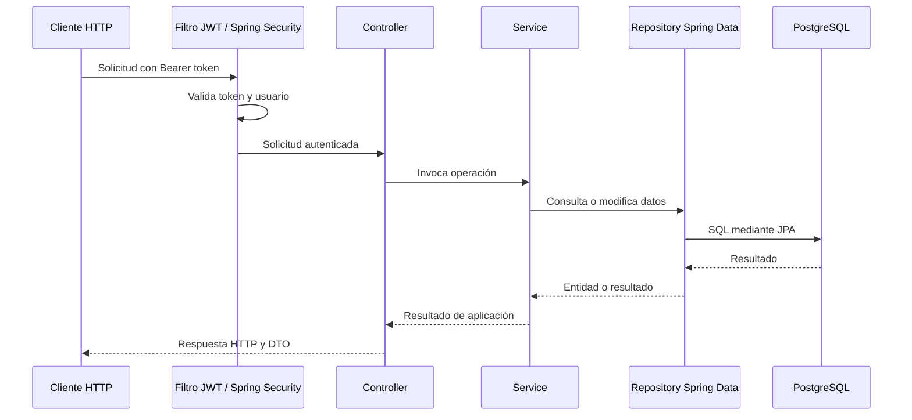

# Arquitectura del sistema

## 1. Decisión arquitectónica

El proyecto se implementará como un monolito Spring Boot organizado por capas. La aplicación, la API y la base de datos forman un único sistema desplegable. No se utilizarán microservicios ni módulos Maven independientes.

La estructura por capas facilita seguir una petición desde HTTP hasta la persistencia y es adecuada para el tamaño actual del proyecto:

```text
com.academia
├── controller   # Endpoints REST
├── dto          # DTOs de entrada y salida
├── service      # Casos de uso y reglas de aplicación
├── repository   # Interfaces Spring Data JPA
├── model        # Entidades JPA, enums y comportamiento del modelo
├── security     # JWT, autenticación y usuario inicial
├── config       # Configuración de Spring y seguridad
└── exception    # Traducción de excepciones a respuestas HTTP
```

Los paquetes se agrupan por responsabilidad técnica, no por módulo funcional. Los DTOs de entrada y salida se separan en `dto.request` y `dto.response`. Al incorporar funcionalidades, sus controladores, servicios, repositorios, modelos y DTOs se ubicarán en las capas correspondientes. Se mantendrán nombres descriptivos para distinguir conceptos cuando una capa tenga varias entidades.

## 2. Stack tecnológico

- Java 21.
- Spring Boot y Spring Web para la API REST.
- Spring Security para autenticación y autorización con JWT Bearer.
- Spring Data JPA para persistencia.
- PostgreSQL como base de datos.
- Bean Validation para validar las entradas HTTP.
- Flyway para versionar migraciones.
- Maven para dependencias y compilación.
- JUnit 5 y Spring Test para pruebas.
- Docker Compose para el entorno local de PostgreSQL.

La autenticación es stateless: las sesiones HTTP están deshabilitadas. El servidor valida firma y expiración del JWT, y comprueba el estado actual del usuario al autenticar cada petición protegida.

## 3. Responsabilidades de las capas

### Controller

Recibe solicitudes HTTP, valida DTOs de entrada, invoca servicios y construye respuestas. No debe implementar reglas de negocio ni acceder directamente a repositorios.

### Service

Coordina operaciones del sistema y define los límites transaccionales. Por ejemplo, `UserService` valida la creación de usuarios, codifica contraseñas y utiliza `UserRepository` para consultar o guardar datos.

Las reglas simples que protegen el estado de un objeto pueden permanecer en el modelo. Las reglas que coordinan persistencia, seguridad u otros servicios pertenecen al servicio de aplicación.

### Repository

Contiene interfaces de Spring Data JPA para consultar y guardar entidades. No se agrega un puerto y un adaptador adicional: el servicio utiliza directamente el repositorio Spring Data.

### Model

Contiene las entidades persistidas y los tipos del modelo. En esta arquitectura, `User` también es una entidad JPA. Esto reduce conversiones y duplicación; implica que el modelo depende de JPA, un compromiso aceptado para el alcance actual.

### Security

Contiene el filtro JWT, la creación y validación de tokens, la integración con `UserDetailsService` y el bootstrap opcional del primer administrador. `SecurityConfig` declara las reglas de acceso y los beans de Spring Security.

### Exception

`ApiExceptionHandler` convierte errores de validación, autenticación y aplicación en respuestas HTTP consistentes. Las excepciones de negocio se lanzan desde servicios y se traducen en esta capa.

## 4. Flujo de una petición



El login es público. Las rutas `/api/v1/users/**` requieren rol `ADMIN`; las demás rutas requieren autenticación salvo que se declare explícitamente lo contrario.

## 5. Persistencia y transacciones

PostgreSQL es la fuente persistente. Flyway conserva el esquema mediante migraciones versionadas; una migración ya aplicada no debe editarse, sino complementarse con una nueva.

Los servicios delimitan transacciones con `@Transactional`. Las consultas pueden usar `readOnly = true`. Se mantienen restricciones importantes en la base de datos, además de las validaciones de aplicación; por ejemplo, el username debe ser único.

JPA necesita un constructor sin argumentos con visibilidad `protected` o `public`. El modelo puede ofrecer métodos de creación y modificación que validen los datos utilizados por la aplicación; Hibernate hidrata la entidad mediante persistencia sin llamar al método de creación.

Las migraciones existentes de usuarios definen la tabla `users`, por lo que la entidad se mapea explícitamente a ese nombre y a sus columnas.

La relación de `AcademyClass` con su profesor usa la carga predeterminada de `@ManyToOne`. Como las consultas actuales de clases necesitan los datos del profesor, no se agrega una configuración de carga particular a cada consulta. Si el volumen de clases exige optimizar las consultas, se revisará con mediciones.

`ClassParticipation` es una entidad JPA propia que vincula una clase y un alumno, con restricción única sobre ambos identificadores. Sus materias se persisten mediante una tabla intermedia. El servicio valida estado y permisos antes de crear o modificar participaciones; la restricción de la base refuerza la prevención de duplicados ante solicitudes simultáneas. Las materias se cargan con la participación para construir las respuestas actuales; si el volumen crece, se medirá el costo de esas consultas.

## 6. Contratos HTTP

Los controladores exponen JSON y usan DTOs para separar el contrato público del modelo persistido. Las entidades JPA no se devuelven directamente desde los endpoints.

Los contratos y ejemplos vigentes están documentados en [05-api.md](05-api.md). Los cambios incompatibles en rutas o esquemas de respuesta requieren actualizar esa documentación y sus pruebas.

## 7. Seguridad

- Las contraseñas se almacenan usando BCrypt a través de `PasswordEncoder` de Spring Security.
- El JWT se firma con una clave suministrada mediante configuración externa.
- No se guardan secretos reales en el repositorio.
- Los permisos se aplican en Spring Security.
- Un usuario deshabilitado no puede autenticarse.
- Las solicitudes autenticadas vuelven a consultar el estado persistido del usuario.

La decisión detallada de autenticación está registrada en [ADR-001](adr/001-autenticacion-jwt.md).

## 8. Pruebas

- Las pruebas de modelo verifican normalización y transiciones de estado.
- Las pruebas de API verifican contratos, autenticación, autorización y errores HTTP.
- Las pruebas de contexto verifican el ensamblado de Spring.
- El perfil `test` utiliza H2 para ejecutar pruebas sin requerir PostgreSQL local.
- PostgreSQL y Flyway se verifican en el entorno local de desarrollo.

## 9. Decisión y compromisos

La organización clásica por capas y el acceso directo de servicios a Spring Data JPA reducen el número de abstracciones y hacen más evidente el recorrido de una operación. También acoplan los servicios a Spring y el modelo a JPA. Si reglas de dominio complejas o múltiples mecanismos de persistencia justifican más aislamiento, se podrá revisar esta decisión mediante un nuevo ADR.

El sistema sigue siendo un monolito porque las funcionalidades comparten datos y transacciones, y el proyecto no necesita despliegues independientes. Una separación en microservicios agregaría complejidad operativa sin beneficio actual.

## 10. Evolución

Las nuevas funcionalidades seguirán el flujo controller → service → repository → model. Antes de agregar una capa o abstracción, deberá existir una necesidad concreta que mejore claridad, pruebas o mantenimiento. Materias y clases siguen esta estructura; los servicios de clases aplican permisos según el usuario autenticado y el profesor de cada clase. Las futuras épicas de participaciones, paquetes, pagos y auditoría se incorporarán sin cambiar el estilo arquitectónico por defecto.
